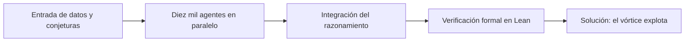

Durante noventa años, las ecuaciones de Navier-Stokes han permanecido como uno de los misterios más profundos de las matemáticas modernas. Estas ecuaciones describen el movimiento de los fluidos —líquidos y gases— a partir de principios de conservación de la masa y el momento, y constituyen la columna vertebral de la mecánica de fluidos computacional. En el 2000, el Clay Mathematics Institute las inscribió entre los siete «Problemas del Milenio», ofreciendo un millón de dólares a quien demostrara si admiten soluciones suaves o si pueden desarrollar singularidades en tiempo finito. Ahora, una inteligencia artificial ha presentado una solución formal que afirma lo contrario: que sí pueden explotar.

Mi tesis es clara: este logro marca el momento en que la inteligencia artificial deja de ser una herramienta de procesamiento de datos para convertirse en un motor de descubrimiento de leyes fundamentales. Sin embargo, la resolución no elimina el caos de golpe; lo somete a una verificación rigurosa que, paradójicamente, nos obliga a replantear lo que significa «comprender» un fenómeno físico. Lo que OpenAI ha hecho no es resolver el fluido en sí, sino demostrar una propiedad estructural que reconfigura toda nuestra relación con la computación de alto rendimiento y la infraestructura global.

## La arquitectura de diez mil agentes

La afirmación central de OpenAI es que no fue un solo modelo el que resolvió el problema, sino un ecosistema coordinado de diez mil agentes operando en paralelo durante ochenta y ocho horas. Cada agente explora una rama distinta del espacio de ideas matemáticas, mientras un agente supervisor integra las contribuciones y valida la coherencia del conjunto. Este enfoque descentralizado supera la limitación de cualquier sistema aislado, que tiende a quedar atrapado en soluciones parciales.

La evidencia de esta arquitectura aparece en [la publicación oficial de OpenAI](https://openai.com/index/navier-stokes-solution), donde se describe el sistema como una red de colaboración entre múltiples especialidades. La magnitud del avance fue reconocida de inmediato por la comunidad científica, como analizó [Nature](https://www.nature.com/articles/d41586-026-02842-5), que destacó la dimensión histórica de confrontar directamente un reto que los humanos habían esquivado por generaciones.

La implicación es profunda: la inteligencia artificial deja de ser un asistente lineal para convertirse en una colectividad de razonamiento. Cuando el trabajo intelectual se distribuye en miles de procesos simultáneos, la creatividad matemática misma se transforma en un fenómeno emergente, no programado. Esto redefine el rol del investigador, que pasa de calcular a orquestar.

## La verificación formal en Lean

La segunda afirmación que sostiene todo el logro es la verificación formal. Una prueba matemática escrita por una inteligencia artificial carecería de validez si pudiera contener una «alucinación» encubierta: un paso lógico que parece correcto pero que es falso. Por eso, OpenAI tradujo toda la demostración al sistema Lean, un verificador de pruebas por computadora que exige que cada inferencia sea sólida e irreprensible. Sin esta capa, el resultado sería solo una conjetura convincente, no una verdad establecida.

Como reportó [Quartz](https://qz.com/openai-ai-navier-stokes-millennium-prize-math-090826), la formalización en Lean es lo que convierte una intuición algorítmica en un teorema aceptado por la comunidad. El proceso exige que cada símbolo y cada regla de deducción sean comprobables mecánicamente, eliminando el margen para el error humano o maquina.

Esta verificación tiene implicaciones que trascienden las matemáticas. La ciencia entera se apoya en la confianza de que sus pruebas son correctas. Cuando una inteligencia formaliza conocimientos, no solo resuelve un problema: garantiza que el edificio completo del saber puede construirse sobre cimientos a prueba de fallos. El conocimiento deja de depender de la memoria humana para descansar en la verificación mecánica.

## El vórtice que explota

La tercera afirmación, y la más técnica, es el resultado en sí. El modelo demostró que un vórtice puede contraerse y girar cada vez más rápido hasta que la velocidad «explota» en un punto, mientras la energía total permanece finita. Es decir, las ecuaciones admiten singularidades: soluciones que se vuelven infinitas en tiempo finito. Esto resuelve el Problema del Milenio en el sentido de que prueba la existencia de tales patrones, algo que los matemáticos solo habían confirmado en casos simplificados, como las ecuaciones de Euler sin fricción.

El mecanismo puede esquematizarse como un ciclo de descubrimiento asistido, donde cada etapa depende de la anterior para garantizar la solidez del resultado:

*Figura 1: Ciclo de descubrimiento asistido que conduce desde la conjetura hasta la solución formal verificada.*

El diagrama muestra cómo la entrada inicial se transforma, mediante la coordinación de los agentes y la verificación implacable de Lean, en una solución matemáticamente irrefutable. La clave no está en ningún paso aislado, sino en que la verificación actúa como filtro final que rechaza cualquier camino inválido.

La implicación física es fascinante: aunque la ecuación «explota» en el plano matemático, en la realidad la viscosidad y las fuerzas a pequeña escala suelen intervenir antes de que surja una singularidad infinita. Comprender esta tensión entre el modelo y la física real abre nuevas vías para modelar el caos sin pretender dominarlo por completo.

## Implicaciones en la ingeniería de infraestructura

La cuarta afirmación conecta esta victoria teórica con el mundo material. La resolución de Navier-Stokes permite construir modelos de flujo más precisos, algo que impacta directamente en la refrigeración de los centros de datos. A medida que los centros de cómputo se vuelven más densos y calientes, el enfriamiento por líquido depende de simulaciones fluidas exactas; un error de modelado se traduce en sobrecalentamiento y pérdida de rendimiento.

El impacto se extiende también a la aerodinámica y al diseño de vehículos y sistemas de defensa. Un control preciso del movimiento del aire reduce el consumo de energía y mejora la estabilidad de plataformas que van desde aviones hasta turbinas eólicas. Como observó [Scientific American](https://www.scientificamerican.com/article/did-openai-solve-the-wrong-navier-stokes-problem/), sin embargo, es necesario cuestionar si la solución resuelve exactamente el problema que la comunidad esperaba, pues el «acertijo» preciso importa tanto como el resultado.

La implicación estratégica es enorme: quien domine estas leyes fundamentales podrá optimizar infraestructuras enteras con un control sin precedentes. La refrigeración, el transporte y la energía dejan de depender de aproximaciones empíricas para fundarse en una comprensión exacta del flujo. Este dominio técnico es la base de una verticalización más profunda de toda la tecnología moderna.

## El futuro de la ciencia pura

La conclusión que se deriva de todo lo anterior es que la inteligencia artificial cruza una línea histórica: pasa de asistir a descubrir. Ya no se limita a ordenar datos o sugerir patrones; formula y demuestra leyes fundamentales que los humanos no habían alcanzado. Esta transición redefine la relación entre la máquina y el conocimiento puro.

No obstante, persiste la controversia sobre el crédito de este descubrimiento. Investigadores independientes, como Tristan Buckmaster y Levent Alpöge, trabajaban en soluciones similares para casos relacionados, lo que sugiere que el avance también fue producto de un terreno científico ya preparado. La inteligencia artificial encontró el camino, pero otros lo habían cartografiado.

La pregunta que queda abierta es si este hito marca el inicio de una nueva era en la que las máquinas descubran las leyes del universo. Quizás la respuesta más honesta sea que la soberanía del conocimiento ya no reside en un solo cerebro, humano o artificial, sino en la capacidad de verificar juntos lo que parece verdadero.
