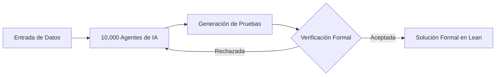

## El problema que la humanidad arrastró durante noventa años

Hay problemas matemáticos que parecen dormidos, escondidos en los márgenes de un campo de estudio, esperando a que alguien tenga la lucidez suficiente para darles fin. El problema de Navier-Stokes fue, durante casi un siglo, exactamente eso.

Las ecuaciones que describen cómo se mueven los fluidos —el aire que circula sobre las alas de un avión, el agua que recorre las tuberías de una ciudad, el humo que se eleva de una vela— fueron formuladas a mediados del siglo XIX. Sin embargo, comprender si esas ecuaciones siempre producen resultados "suaves" o si pueden comportarse de formas patológicas sigue sin estar resuelto de forma general.

La dificultad no es superficial. Se trata de uno de los siete "Problemas del Milenio" que el Instituto Clay ofreció valorar con un millón de dólares cada uno. La pregunta central era clara y devastadora: ¿pueden las soluciones desarrollar singularidades, puntos donde la velocidad se vuelva infinita, en un tiempo finito?

Durante noventa años, la comunidad matemática resolvió el caso en situaciones idealizadas, como las ecuaciones de Euler sin fricción. El caso completo, con viscosidad, resistió a las mentes más brillantes de la historia reciente. Hasta que apareció una máquina.

## La IA como nueva especie de matemático

Lo que OpenAI anunció no fue simplemente una simulación más precisa de fluidos. Fue una demostración de que un sistema artificial podía demostrar un teorema que durante décadas resistió a los humanos.

La metodología empleada resultó tan extraordinaria como el resultado. El modelo interno de alta capacidad coordinó a diez mil agentes trabajando en paralelo durante ochenta y ocho horas, explorando el espacio de pruebas con una densidad de búsqueda imposible para un solo investigador.

Pero el verdadero milagro no fue la potencia bruta. Fue la verificación formal. La prueba fue escrita y validada en *Lean*, un sistema de verificación de pruebas por computadora que comprueba cada paso de la lógica con exactitud axiomática.

Sin esa capa de verificación, cualquier "solución" generada por una IA carecería de validez científica. Sería una alucinación con apariencia de teorema. Lean convierte la salida de la red en una verdad verificable, no en una suposición convincente.

## Lo que la prueba finalmente demostró

El resultado técnico tiene una elegancia inquietante. El modelo demostró que un vórtice puede contraerse y girar cada vez más rápido, elevando la velocidad hasta que "explota" en un punto concreto.

Lo fascinante de este hallazgo es la contradicción aparente. Mientras la velocidad tiende a lo infinito en ese punto, la energía total del sistema permanece finita. No hay locura matemática; hay una singularidad perfectamente contenida en su energía.

Este hallazgo resuelve una rama específica del problema, mostrando que las singularidades sí pueden formarse en tiempo finito. Es un avance monumental, pero conviene entender bien qué significa y qué no significa.

## La singularidad matemática frente a la realidad física

Antes de celebrar, es preciso trazar una línea divisoria entre las matemáticas puras y el mundo físico. Que la ecuación "explote" en un punto no implica que en la naturaleza ocurra exactamente lo mismo.

En la realidad, la viscosidad y otras fuerzas a pequeña escala suelen intervenir mucho antes de que se alcance una singularidad infinita. Los fluidos reales tienen límites que las ecuaciones idealizadas pueden ignorar.

Este matiz es crucial para ingenieros y físicos. La prueba confirma la estructura profunda de las ecuaciones, pero la implementación práctica en simulaciones de flujo sigue dependiendo de modelos que respetan la física del mundo real.

## El debate sobre el crédito y los incentivos

Ningún descubrimiento histórico ocurre en el vacío, y este no fue la excepción. Existe un debate activo sobre quién merece el crédito de esta resolución.

Investigadores independientes, como Tristan Buckmaster y Levent Alpöge, venían trabajando en direcciones similares para casos relacionados durante años. Sus contribuciones previas crearon el terreno fértil donde OpenAI plantó su resultado.

Esta tensión revela algo profundo sobre los incentivos de la ciencia contemporánea. Cuando una corporación con recursos masivos resuelve lo que un academia sin financiació largamente esquivó, las preguntas sobre autoría se vuelven inevitables.

El mérito ya no se mide solo por la idea, sino por la capacidad de ejecutarla con recursos. Este es un momento para celebrar el avance, pero también para cuestionar cómo distribuimos el reconocimiento.

## Cómo esto transforma la refrigeración líquida

Quizá la aplicación menos ob pero más transformadora de este avance se encuentra en la refrigeración de supercomputadoras. Los centros de datos modernos se calientan a un ritmo que desafía las técnicas tradicionales de enfriamiento por aire.

Un modelo de flujo más preciso permite diseñar sistemas de enfriamiento por líquido que aprovechan al máximo las propiedades termodinámicas de los fluidos. Comprender la turbulencia a nivel profundo significa optimizar el transporte de calor con una eficiencia antes inimaginable.

OpenAI ya invierte pesadamente en esta intersección. La refrigeración líquida directa del chip se ha convertido en un campo de batalla crítico, y dominar las leyes de flujo ofrece una ventaja competitiva directa.

Menos energía desperdiciada en enfriamiento significa más potencia de cómputo dedicada al cálculo real. En un mundo donde los data centers consumen porcentos crecientes de la electricidad global, esto no es un lujo técnico; es una necesidad estratégica.

## Aerodinámica, defensa y el diseño del futuro

Otra frontera se abre en la aerodinámica y el diseño de vehículos. Durante décadas, la optimización de formas ha dependido de la mecánica de fluidos computacional (CFD), un campo costoso e imperfecto.

Con modelos de flujo más precisos, el diseño de aviones, automóviles e incluso sistemas de defensa puede alcanzar niveles de eficiencia antes reservados a la simulación teórica. La predicción de la turbulencia deja de ser un estim para convertirse en una certeza calculable.

Esto tiene implicaciones económicas enormes. Cada fracción de punto de reducción en la resistencia aerodinámica se traduce en millones de litros de combustible ahorrados a escala global. La física pura, al fin, se monetiza.

## La transición de la IA de asistente a descubridor

Lo que estamos presenciando marca un cambio de paradigma en la relación entre la inteligencia artificial y la ciencia pura. Durante años, la IA fue un asistente: procesaba datos, clasificaba imágenes, sugería hipótesis.

Ahora se convierte en un descubridor de leyes fundamentales. No se trata de optimizar lo existente, sino de resolver lo que los humanos jamás lograron. La transición es profunda y, en cierto sentido, irreversible.

Este nuevo rol plantea preguntas filosóficas apremiantes. Si una máquina puede demostrar teoremas que resistieron a generaciones de matemáticos, ¿cuál es el lugar del investigador humano en el proceso científico?

La respuesta más probable no es la sustitución, sino la colaboración. La IA encuentra la ruta; el humano aporta la intuición, la dirección y, sobre todo, la verificación crítica que da sentido a todo descubrimiento.

## El costo oculto de la inteligencia artificial

Es fácil enamorarse del logro y olvidar su precio. La resolución de Navier-Stokes requirió diez mil agentes durante ochenta y ocho horas, consumiendo una cantidad de energía computacional difícil de dimensionar.

Este es el trade-off fundamental de la era. Podemos resolver problemas imposibles, pero el costo energético y económico de hacerlo sigue siendo astronómico. La implementación práctica de estas soluciones seguirá requiriendo potencia de cómputo masiva.

La prueba de concepto demuestra que la IA puede encontrar la "solución maestra", pero convertir esa solución en una herramienta cotidiana es otra empresa completamente distinta. El camino desde el laboratorio hasta la industria es largo y costoso.

## Soberanía de hardware y conocimiento

Todo este ecosistema converge en una idea central: la soberanía tecnológica. Quien domine tanto el hardware como el conocimiento fundamental tendrá una ventaja que será difícil de igualar.

La verticalización de la tecnología avanza a un ritmo vertiginoso. Las empresas que controlan desde los chips hasta las ecuaciones que gobiernan el mundo físico poseen un poder que trasciende lo comercial.

Este es el verdadero significado del avance de OpenAI. No es solo un logro matemático; es una declaración de capacidad para controlar las capas más profundas de la realidad y la infraestructura.

## El punto de inflexión

Lo que comenzó como un problema de noventa años ha terminado por revelar algo mucho más grande. La inteligencia artificial ha dejado de ser una herramienta de procesamiento de datos para convertirse en un motor de descubrimiento.

Este no es el final de una era, sino el comienzo de otra. Las fronteras entre la matemática, la física y la informática se difuminan, y las posibilidades se multiplican a un ritmo que apenas comenzamos a comprender.

Para ingenieros, investigadores y entusiastas de la física, el mensaje es claro: el caos fluido ha dejado de ser un misterio. Ahora depende de nosotros decidir cómo utilizar esta nueva soberanía.

El futuro de la ingeniería ya no es solo humano. Y eso, en el mejor de los casos, es exactamente lo que debíamos esperar.
