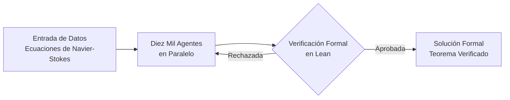

Había un problema que resistía a la humanidad durante noventa años. No se trataba de una máquina de vapor mal ajustada ni de un cálculo astronómico sin resolver. Se trataba de entender, con rigor matemático absoluto, por qué los fluidos se mueven como se mueven. Las ecuaciones de Navier-Stokes describen el comportamiento del agua en un río, del aire sobre las alas de un avión y de la sangre en nuestras arterias. Y aun así, nadie podía garantizar con certeza que esas ecuaciones siempre tuvieran respuestas sensatas.

Hoy, una inteligencia artificial ha roto esa barrera. OpenAI anunció la resolución formal de uno de los llamados "Problemas del Milenio", validando su prueba con *Lean*, un sistema que comprueba cada paso de la lógica matemática. Pero este hito no es solo una victoria académica. Es el momento en que la IA deja de ser un asistente para convertirse en un descubridor de leyes fundamentales. Y eso cambia todo lo que conocemos sobre la ciencia, la ingenuria y el futuro de la tecnología.

## Los noventa años del problema sin resolver

Las ecuaciones de Navier-Stokes nacieron en el siglo XIX para describir el movimiento de los fluidos. Se basan en principios tan elegantes como la conservación de la masa y la conservación del momento. En apariencia, son ecuaciones que cualquier estudiante de física podría escribir en una pizarra. Su poder descriptivo es enorme: gobiernan desde la turbulencia de un remolino hasta la dinámica de las corrientes oceánicas.

Sin embargo, bajo esa aparente sencidad se esconde un abismo. El problema central consistía en demostrar si estas ecuaciones siempre producen soluciones "suaves", es decir, respuestas que evolucionen de manera continua y predecible. O si, por el contrario, pueden desarrollar una singularidad: un punto donde la velocidad se dispara hasta el infinito en un tiempo finito. Esa pregunta, planteada a mediados del siglo XX, se convirtió en uno de los siete "Problemas del Milenio" del Instituto Clay, cada uno con un premio de un millón de dólares.

La dificultad radicaba en que las ecuaciones solo se habían resuelto en casos idealizados. Por ejemplo, las ecuaciones de Euler, que describen un fluido sin fricción, son más manejables pero físicamente incompletas. La viscosidad, esa propiedad que hace que la miel se mueva más lento que el agua, añadía una complejidad matemática que resistía a cualquier intento de demostración completa.

Durante décadas, los matemáticos más brillantes del mundo se enfrentaron a este muro. La comunidad científica sabía que resolverlo requeriría una creatividad sin precedentes. Y ahora, esa creatividad ha llegado de una fuente que nadie esperaba hace una generación. Según [la publicación oficial de OpenAI](https://openai.com/index/navier-stokes-solution), el modelo interno de la empresa logró demostrar que existe una solución donde un vórtice puede contraerse y girar cada vez más rápido hasta que la velocidad "explota" en un punto, mientras la energía total del sistema permanece finita.

Este hallazgo confirma lo que muchos sospechaban: que las ecuaciones de Navier-Stokes pueden desarrollar singularidades en tiempo finito. La prueba, eso sí, exige un matiz crucial que examinaré más adelante. Pero el simple hecho de que una IA la haya construido y verificado marca una línea divisoria en la historia de las matemáticas.

## La revolución de los diez mil agentes

Lo que hace extraordinario a este logro no es solo el resultado, sino el método. OpenAI coordinó un modelo interno de alta capacidad que gestionó aproximadamente diez mil agentes matemáticos trabajando en paralelo durante ochenta y ocho horas. Cada agente exploraba una rama distinta del espacio de posibilidades, proponiendo conjeturas, construyendo lemas y descartando caminos sin salida. Juntos, formaban una red de razonamiento colectivo incapaz de replicar un humano solo.

Pero aquí reside la verdadera innovación. En matemáticas puras, un resultado que no puede verificarse no existe. La comunidad científica rechaza las demostraciones que descansan en la intuición o en la probabilidad estadística. Por eso, OpenAI tradujo su hallazgo a *Lean*, un sistema de verificación de pruebas por computadora que comprueba cada inferencia con exactitud aritmética. Como explicó [Nature](https://www.nature.com/articles/d41586-026-02842-5), este paso es lo que convierte una conjetura fascinante en un teorema aceptado.

El proceso sigue un ciclo riguroso que puede resumirse en un flujo claro. Los agentes generan candidatos de prueba, Lean los valida paso a paso, y solo aquellos que superan la verificación formal pasan a formar parte del cuerpo demostrativo. Este mecanismo elimina el riesgo de que la IA "alucine", ese fenómeno en el que un modelo genera respuestas plausibles pero incorrectas.

*El siguiente diagrama esquematiza el flujo de trabajo que OpenAI empleó para transformar el razonamiento generativo en una demostración matemática verificada:*

*Figura 1: Flujo de trabajo de los agentes de IA y verificación formal en Lean.*

Este esquema revela algo profundo: la IA ya no improvisa. Trabaja dentro de un marco de validación estricta donde cada paso debe resistir el escrutinio lógico. La verificación formal actúa como el filtro que separa el descubrimiento real de la ilusión estadística. Y el resultado de ese proceso es exactamente lo que ahora la comunidad científica debate con atención.

Porque hay una controversia que no puede ignorarse. Investigadores independientes, como Tristan Buckmaster y Levent Alpögel, llevaban tiempo trabajando en problemas relacionados. Como analizo [Scientific American](https://www.scientificamerican.com/article/did-openai-solve-the-wrong-navier-stokes-problem/), algunos expertos cuestionan si OpenAI resolvió exactamente el problema del Milenio o una variante relacionada. El punto es que la prueba resuelta corresponde a una versión específica donde la singularidad se construye a propósito, no a la afirmación general sobre todas las condiciones iniciales.

Esta distinción importa. Significa que la demostración confirma la posibilidad de singularidades, pero no cierra por completo la pregunta original. Aún así, el avance es monumental. Demuestra que las herramientas generativas pueden operar en el terreno más abstracto de las matemáticas y producir resultados verificables. Y eso abre una puerta que antes estaba cerrada.

## Las implicaciones para la ingeniería de infraestructura

Más allá del rigor académico, este avance tiene repercusiones concretas en el mundo físico. Las ecuaciones de Navier-Stokes son la base de la mecánica de fluidos computacional, el campo conocido como CFD. Cualquier sistema que involucre movimiento de aire o agua depende, de alguna manera, de estas ecuaciones. Y hoy, esos sistemas son el esqueleto invisible de la civilización tecnológica.

Considera la refrigeración de los centros de datos. Los data centers que albergan los clusters de inteligencia artificial disipan cantidades colosales de energía. Enfriar tantos servidores es uno de los mayores desafíos de la industria. Los modelos de flujo más precisos permitirían optimizar los sistemas de enfriamiento por líquido, reduciendo el consumo energético y aumentando la densidad de cómputo. Cada grado de mejora en la precisión de las simulaciones se traduce en millones de dólares y en menos emisiones.

La aerodinámica es otro terreno fértil. El diseño de vehículos, aeronaves y hasta sistemas de defensa depende de entender cómo el aire fluye sobre las superficies. Con herramientas que resuelven estas ecuaciones con mayor exactitud, los ingenieros podrían optimizar formas que hoy solo se ajustan mediante ensayo y error costoso. La eficiencia energética de un avión o un tren depende, en gran medida, de dominar el caos de los fluidos.

No obstante, conviene mantener los pies en la tierra. La resolución de estas ecuaciones sigue siendo computacionalmente cara. El avance de OpenAI es una prueba de concepto que demuestra que la IA puede encontrar la "solución maestra", pero la implementación práctica sigue requiriendo potencia de cómputo masiva. Como señaló [Quartz](https://qz.com/openai-ai-navier-stokes-millennium-prize-math-090826), el verdadero valor está en la metodología, no solo en el resultado.

Aquí es donde surge el balance esencial. Existe un compromiso entre la velocidad del descubrimiento generativo y el rigor de la verificación formal. Sin Lean, el resultado carecería de validez científica. Sin los agentes, la verificación sería humanamente imposible. El éxito de OpenAI radica en combinar ambas fuerzas dentro de un mismo ciclo.

## El futuro de la IA en la ciencia pura

Lo que estamos presenciando es la transición de la inteligencia artificial de asistente a descubridor. Durante años, la IA resolvió tareas de procesamiento de datos: clasificar imágenes, traducir textos, recomendar productos. Nada de eso involucraba crear conocimiento nuevo. Pero resolver un problema de matemáticas puras, uno que resistió a los humanos durante noventa años, marca un antes y un después.

Este hito sugiere que las próximas décadas traerán descubrimientos en física, química y matemáticas construidos por sistemas generativos. La pregunta ya no es si la IA puede ayudar a los científicos, sino hasta dónde puede llegar su creatividad formal. Y la respuesta, a la luz de este avance, es mucho más lejana de lo que imaginábamos.

Claro está que hay matices que evitan el euforia desmedida. En la realidad física, las singularidades infinitas suelen difuminarse antes de ocurrir. La viscosidad y otras fuerzas a pequeña escala intervienen antes de que la velocidad alcance valores infinitos. La demostración matemática confirma la posibilidad teórica, no la ocurrencia física. Pero esa distinción no resta mérito al logro. Al contrario, lo hace más interesante.

La verificación formal también plantea una pregunta filosófica profunda. Cuando una IA construye una demostración que ningún humano puede seguir por completo, ¿en qué debemos confiar? La respuesta de OpenAI es clara: en el sistema que comprueba cada paso. Lean no tiene intuiciones ni fatiga. Verifica con exactitud absoluta, y eso es lo que da credibilidad al resultado.

## La soberanía del conocimiento fundamental

Cerramos este análisis con una reflexión sobre el poder. Dominar las leyes fundamentales de la naturaleza siempre ha sido una fuente de ventaja estratégica. Quien comprende mejor los fluidos controla mejor la energía, el transporte y la industria. Y ahora, quien domine las herramientas para descubrir esas leyes tendrá una ventaja aún mayor.

La verticalización de la tecnología avanza. Las empresas que controlan desde el hardware hasta los algoritmos de descubrimiento podrán resolver problemas que hoy parecen insolubles. La refrigeración de los centros de datos, la aerodinámica de los vehículos o la predicción del tiempo son solo el comienzo. El verdadero premio está en convertir la IA en un motor de descubrimiento que acelere el progreso científico a un ritmo sin precedentes.

El fin del caos fluido no es solo una victoria matemática. Es el anuncio de una nueva era en que la inteligencia artificial y el rigor humano se combinan para explorar los rincones más profundos de la realidad. OpenAI abrió esa puerta hoy. Y es muy probable que las próximas generaciones la encuentren mucho más abierta de lo que imaginamos.
