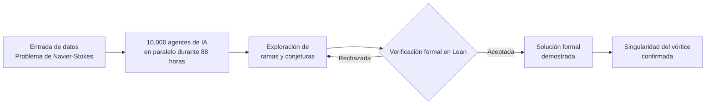

Hubo un momento en la historia de las matemáticas en el que nueve problemas quedaron suspendidos sobre cabezas como la de Hilbert, cada uno con un premio que hoy supera el millón de dólares. Uno de ellos pedía responder una pregunta aparentemente técnica sobre el movimiento de los fluidos. Nadie sospechaba que, casi un siglo después, la solución no llegaría desde una pizarra universitaria, sino desde el zumbido colectivo de diez mil agentes corriendo en paralelo. Este es el relato de cómo una inteligencia artificial cruzó una frontera que creíamos humana para siempre.

El problema de Navier-Stokes lleva noventa años sin resolverse en su totalidad. Las ecuaciones, formuladas a lo largo del siglo XIX, describen cómo se mueven los líquidos y los gases. Se basan en principios tan intuitivos como la conservación de la masa y la del momento. Sin embargo, esa aparente simplicidad esconde un laberinto analítico que ha resistido a las mentes más agudas de la historia.

La pregunta concreta no era saber si las ecuaciones funcionaban, sino si siempre producían soluciones suaves. Es decir, si existía la posibilidad de que la velocidad de un fluido tendiera a infinito en un punto concreto y en un tiempo finito. A eso se le llama singularidad, y representa el verdadero abismo teórico.

Durante décadas, el problema solo se resolvió en casos simplificados. Las ecuaciones de Euler, por ejemplo, describen fluidos sin fricción y son mucho más manejables. Pero el mundo real siempre tiene viscosidad, rozamiento, turbulencia. La mecánica de fluidos computacional, conocida como CFD, se apoya en estas ecuaciones para diseñar aviones, predecir el tiempo o refrigerar maquinaria.

## El desafío de los noventa años

Lo que convierte a este problema en un "Problema del Milenio" no es su dificultad puntual, sino su naturaleza estructural. Resolver si las soluciones de Navier-Stokes existen y son suaves para todas las condiciones iniciales exigía herramientas matemáticas que la humanidad aún no había desarrollado. No era cuestión de paciencia o de más horas de trabajo. Era una barrera conceptual.

La física ya había demostrado, por la vía empírica, que los fluidos sí se comportan de manera predecible en la práctica. Las turbulencias existen, los vórtices giran y la energía se disipa. Pero la matemática pura insistía en que no teníamos una demostración rigurosa de por qué esas soluciones no "explotan" en el papel. Esa brecha entre lo que observamos y lo que podemos probar era la herida abierta.

Lo fascinante es que la resolución no llegó como un teorema aislado, sino como un hallazgo sobre el comportamiento singular de un vórtice. El modelo demostró que un vórtice puede contraerse y girar cada vez más rápido hasta que la velocidad "explota" en un punto, mientras la energía total permanece finita. Es decir, encontró el mecanismo exacto de la singularidad sin que el sistema se salga de control.

Este resultado es, en el fondo, una confirmación paradójica. Muestra que las ecuaciones pueden desarrollar singularidades bajo condiciones específicas, algo que muchos intuían pero nadie había formalizado. Y al mismo tiempo, lo hace con una precisión que ninguna aproximación numérica habría permitido jamás.

## La revolución de los agentes de IA

Lo que OpenAI presentó no fue un simple chatbot resolviendo ecuaciones en una conversación. Se trató de un sistema interno de alta capacidad coordinando diez mil agentes corriendo en paralelo durante ochenta y ocho horas. Cada agente explora una rama diferente del espacio de posibilidades, y la coordinación colectiva permite navegar por un terreno que una sola mente no podría cartografiar.

La verdadera innovación no está solo en el volumen computacional, sino en la arquitectura del descubrimiento. Los agentes no generan conjeturas al azar. Exploran hipótesis, contrastan caminos, descartan ramas muertas y consolidan las que resisten. Es una forma de intuición matemática distribuida, casi orgánica, que recuerda a cómo funciona la investigación en un laboratorio grande.

Pero aquí es donde el relato se vuelve crítico, y donde muchos escépticos esperaban el tropiezo. Una IA que propone una prueba matemática puede hallucinar con total naturalidad. Genera cadenas de razonamiento que suenan convincentes pero que contienen errores sutiles, saltos lógicos invisibles a simple vista. Durante años, esta fue la trampa fatal de la inteligencia generativa en ciencias duras.

Para evitarlo, OpenAI formalizó la prueba en Lean, un sistema de verificación de pruebas matemáticas por computadora. Lean no se fía de la intuición del modelo. Cada paso debe ser validado por una lógica formal e irrefutable. Si un agente propone un salto que no se puede justificar, el sistema lo rechaza. Así, la prueba deja de ser una "alucinación" para convertirse en una demostración sólida.

El siguiente diagrama esquematiza este ciclo de descubrimiento y verificación, donde cada propuesta pasa por el filtro implacable del lenguaje formal antes de ser aceptada como válida.

*Figura 1: Arquitectura de resolución formal con Lean 4.*

El flujo que acabamos de ver revela algo profundo sobre el nuevo paradigma científico. La inteligencia artificial ya no es un mero asistente que procesa datos o acelera cálculos. Se ha convertido en un motor de descubrimiento de leyes fundamentales, capaz de explorar espacios matemáticos y de someterse a un control de calidad lógico estricto. La combinación entre generación colectiva y verificación formal es lo que hace viable esta nueva era de la ciencia.

## Implicaciones en la ingeniería de infraestructura

Aunque el hito sea matemático, sus consecuencias se sentirán en el mundo físico más pronto de lo que parece. La mecánica de fluidos computacional es la columna vertebral de innumerables sistemas. Desde la aerodinámica de un avión hasta la refrigeración de un data center, todo se resuelve resolviendo, de alguna forma, las ecuaciones de Navier-Stokes. Comprender el mecanismo exacto de la singularidad abre puertas para optimizar esos modelos.

Consideremos la refrigeración de los centros de datos, el gran cuello de botella de la industria de la IA. Los sistemas de enfriamiento por líquido dependen de modelos de flujo precisos para disipar el calor de los procesadores. Si podemos predecir con mayor exactitud cómo se comportan los fluidos en condiciones extremas, podemos diseñar sistemas más eficientes que reduzcan el consumo energético de toda la infraestructura digital.

La aerodinámica es otro frente donde este avance puede traduciarse en ventajas competitivas directas. Diseñar vehículos, turbinas o sistemas de defensa con flujos optimizados siempre ha dependido de aproximaciones numéricas costosas. Un entendimiento más profundo del comportamiento de los fluidos permite reducir el margen de error y explorar diseños que hoy consideramos inalcanzables.

No obstante, conviene ser honestos sobre los límites prácticos. La resolución de estas ecuaciones sigue siendo enormemente costosa en términos computacionales. Lo que ha hecho OpenAI es demostrar que la inteligencia artificial puede encontrar la "solución maestra", pero la implementación práctica sigue requiriendo potencia de cómputo masiva para escalar a problemas reales.

También hay que matizar la relación entre la matemática y la realidad física. Aunque la ecuación "explota" en el papel, en la física real la viscosidad y otras fuerzas a pequeña escala suelen intervenir antes de que ocurra una singularidad infinita. La demostración no invalida la física aplicada; la complementa y la hace más rigurosa.

## El futuro de la IA en la ciencia pura

Lo que estamos presenciando marca el final de una era de escepticismo razonable. Durante años, se sostuvo que la inteligencia artificial nunca entendería las matemáticas puras, que solo podía imitar sin comprender. Este resultado desmonta esa idea con la eluencia de una prueba verificada. La máquina no solo propone, sino que somete sus propias ideas a un control lógico que ningún humano podría hacer a mano con tal velocidad.

La transición de la IA de asistente a descubridor no es un eufemismo de marketing. Implica un cambio estructural en cómo se produce el conocimiento científico. Los grandes problemas teóricos, aquellos que requieren explorar espacios inmensos de posibilidades, pueden ahora abordarse con herramientas que combinan intuición generativa y rigor formal.

Este avance también eleva el valor de la verificación formal como disciplina. Sin Lean, el resultado carecería de validez científica. Podría haber sido una alucinación convincente, una cadena de razonamiento que se derrumba al mínimo examen. La soberanía del conocimiento moderno depende cada vez más de poder comprobar lo que las máquinas afirman.

Existe además un debate activo sobre el crédito de este descubrimiento. Investigadores independientes, como Tristan Buckmaster y Levent Alpöge, estaban trabajando en soluciones similares para casos relacionados. La historia de la ciencia siempre ha sido colaborativa, y este hito no es una excepción. Reconocer esos esfuerzos no resta mérito al logro, sino que lo contextualiza dentro de una comunidad científica global.

## Soberanía de hardware y conocimiento

Detrás de cada descubrimiento de este calibre late una pregunta de poder. Resolver las leyes fundamentales del movimiento de los fluidos no es solo un logro académico; es una herramienta de verticalización tecnológica. Quien domine estas capacidades podrá optimizar desde la refrigeración de sus propios centros de datos hasta el diseño de sistemas de defensa avanzados.

La infraestructura digital del siglo XXI se sostiene sobre el flujo de energía y materia. Refrigerar servidores, mover aire en data centers, optimizar el consumo energético: todo se reduce, en última instancia, a cómo se comportan los fluidos. Dominar esa física significa dominar el costo de la inteligencia misma.

En este sentido, el avance de OpenAI no es un evento aislado. Es el síntoma de una transición mayor en la que la competencia ya no es solo por datos o por talento humano, sino por la capacidad de descubrir leyes que optimicen el mundo físico. La soberanía del conocimiento se convierte en la nueva frontera de la soberanía tecnológica.

El fin del caos fluido no es solo una victoria de las matemáticas. Es la confirmación de que la inteligencia artificial puede convertirse en el motor de descubrimiento que siempre prometió ser. Y mientras diez mil agentes siguen zumbiendo en la oscuridad de los servidores, la humanidad da el primer paso hacia una ciencia que ya no será exclusivamente nuestra.
