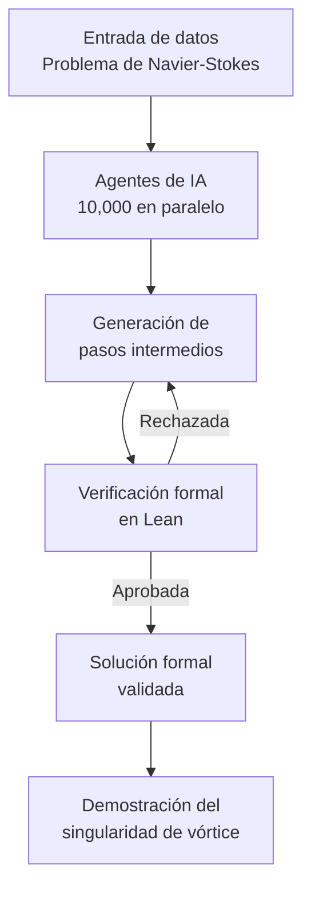

Durante casi un siglo, las matemáticas más rigurosas del planeta miraron hacia un problema que se resistía a rendirse. No era una conjetura menor, ni un ejercicio de salón para estudiantes adelantados. Se trataba de entender si las ecuaciones que describen el movimiento de los fluidos podían, en algún punto, traicionar su propia lógica y explotar en el vacío. La respuesta seguía sin escribirse cuando los grandes nombres de la física matemática ya no eran los mismos de la primera mitad del siglo XX.

Las ecuaciones de Navier-Stokes nacieron de la necesidad humana de predecir lo invisible. Sabemos que el aire que rodea un ala no se mueve al azar, que el agua de un río obedece reglas profundas. Pero entender esas reglas con la precisión que exige las matemáticas ha resultado espinoso. Como recordaba [Nature](https://www.nature.com/articles/d41586-026-02842-5), la magnitud de este avance matemático no puede subestimarse en un campo donde los avances reales son tan escasos.

Lo que hoy se anuncia no es una victoria sobre un reto reciente. Es la resolución formal de una pregunta que ha perdurado desde finales del siglo XIX, muy antes de que el Clay Mathematics Institute la bautizara como uno de sus Problemas del Milenio en el año 2000. Esa confusión histórica ha generado ruido, pero el dato correcto importa: estamos ante casi noventa años de resistencia teórica.

Y ahora, una inteligencia artificial ha cruzado la línea. No con una demostración escrita a mano por un genio solitario, sino con un ejército coordinado de agentes que trabajaron en paralelo. Este es el momento en que la IA deja de ser una herramienta de procesamiento de datos para convertirse en un motor de descubrimiento de leyes fundamentales.

## La revolución de los agentes de IA

El anuncio oficial, publicado por [OpenAI](https://openai.com/index/navier-stokes-solution), describe un sistema sin precedentes. Un modelo interno de alta capacidad coordinó a diez mil agentes matemáticos trabajando en paralelo durante ochenta y ocho horas. No se trata de un único algoritmo resolviendo un ejercicio, sino de una arquitectura colectiva donde cada agente explora una rama distinta de la demostración.

La verdadera innovación no reside solo en la potencia computacional. Reside en el mecanismo de verificación que garantiza que nada de lo producido sea una alucinación. Cada paso de la demostración se formalizó en Lean, el sistema de verificación de pruebas matemáticas por computadora. Sin esa capa de validación, cualquier resultado en matemáticas puras carecería de validez científica.

Es aquí donde el sistema se vuelve fascinante para los ingenieros de infraestructura. Lean no se limita a aceptar respuestas plausibles. Exige que cada inferencia sea sólida, que cada ecuación respete las reglas formales de la lógica. Es el equivalente digital de un revisor implacable que no duerme nunca.

Para comprender cómo fluye este proceso, observemos el ciclo completo de la demostración generada:

*Figura 1: Ciclo de datos desde la entrada del problema hasta la solución formal validada por Lean.*

El diagrama revela algo esencial: el sistema no es una caja negra que escupe respuestas. Es un loop cerrado donde la verificación formal actúa como filtro implacable. Los pasos rechazados vuelven al ciclo, y solo lo sólido sobrevive hasta la conclusión. Esa retroalimentación es lo que separa una alucinación de un teorema.

El resultado técnico, según describe la publicación oficial, es contundente. El modelo demostró que un vórtice puede contraerse y girar cada vez más rápido hasta que la velocidad «explota» en un punto, mientras la energía total permanece finita. Es exactamente el tipo de singularidad que el Problema del Milenio buscaba caracterizar, y lo hace con rigor formal.

## Implicaciones en la ingeniería de infraestructura

La resolución no se queda en el ámbito abstracto. Toca directamente el corazón de la ingeniería de fluidos computacional, el campo que alimenta desde la aerodinámica hasta la refrigeración de centros de datos. Como señalaba [Quartz](https://qz.com/openai-ai-navier-stokes-millennium-prize-math-090826), el anuncio marca el momento en que la IA resuelve formalmente uno de los problemas más temidos de las matemáticas aplicadas.

En la refrigeración de data centers, el desafío es brutal. Los sistemas de enfriamiento por líquido deben gestionar flujos turbulentos que hoy se aproximan numéricamente con un costo enorme. Un modelo de flujo más preciso permitiría optimizar el intercambio térmico sin depender de simulaciones que consumen cantidades masivas de energía.

La eficiencia de estos sistemas condiciona todo el ecosistema de la inteligencia artificial. Un data center más fresco consume menos, rinde más y alarga la vida de los chips. Lo que hoy parece teoría lejana se traduce en vatossavedos y en competitividad real.

En el terreno de la aerodinámica, el impacto es igual de profundo. El diseño de vehículos, alas y sistemas de defensa depende de predecir con exactitud cómo se comporta el aire bajo condiciones extremas. Una solución maestra a las ecuaciones abriría la puerta a optimizaciones que hoy solo se intuyen.

Pero conviene ser honestos sobre los límites. La resolución de estas ecuaciones sigue siendo costosa en términos computacionales. El avance de OpenAI es una prueba de concepto de que la IA puede encontrar la solución correcta, no una garantía de implementación barata.

Aquí aparece el equilibrio que todo ingeniero debe comprender. Sin verificación formal, el hallazgo carecería de sentido. Con ella, gana el estatus de verdad matemática. Esa compensación entre descubrimiento y validación es la clave del método.

## El futuro de la IA en la ciencia pura

La transición de la IA de asistente a descubridor no es menor. Durante décadas, los sistemas solo ayudaban a los humanos a navegar problemas ya formulados. Ahora pueden proponer rutas de demostración que nadie imaginaba, coordinando miles de agentes en direcciones distintas.

No obstante, el anuncio ha despertado un debate activo sobre los créditos y la validez. Investigadores independientes, como Tristan Buckmaster y Levent Alpöge, trabajaban en soluciones similares para casos relacionados. Como analizaba [Scientific American](https://www.scientificamerican.com/article/did-openai-solve-the-wrong-navier-stokes-problem/), surge la pregunta incómoda sobre si se resolvió el problema correcto.

Esta controversia no resta mérito al logro. Lo enriquece. La ciencia avanza cuando las reclamaciones se someten al escrutinio de la comunidad. Que [Yahoo News](https://www.yahoo.com/news/science/articles/openai-blockbuster-navier-stokes-proof-164200516.html) analizara cómo la prueba no es exactamente lo que se esperaba demuestra que el ecosistema científico sigue funcionando.

También hay un matiz físico esencial. Aunque la ecuación «explota» matemáticamente, en la realidad la viscosidad y otras fuerzas de pequeña escala suelen intervenir antes de que ocurra una singularidad infinita. La demostración habla del comportamiento ideal, no necesariamente del caos que observamos en un río real.

Este es el puente hacia una reflexión más amplia. El dominio de estas leyes fundamentales no es solo un triunfo académico. Es una herramienta que permite especializar y optimizar la tecnología en direcciones antes imposibles.

El video de presentación, disponible en [YouTube](https://youtu.be/VKp60PuOzvI), captura visualmente este impacto, mostrando cómo una demostración abstracta se traduce en consecuencias concretas para la ingeniería y la física aplicada. La imagen del vórtice brillando entre ecuaciones flotantes resume la estética de esta nueva era.

## Conclusión: soberanía de conocimiento y especialización técnica

Lo que acaba de ocurrir marca el fin de una era de cautividad teórica. Durante casi noventa años, la humanidad convivió con una pregunta sin responder. Hoy, una arquitectura de agentes coordinados y verificación formal ha cruzado la línea que parecía infranqueable.

Pero el verdadero triunfo no es solo haber resuelto el problema. Es haberlo hecho con el rigor que exige las matemáticas. Lean no perdona, y eso es exactamente lo que hace del hallazgo una verdad y no una ilusión.

Para los ingenieros de infraestructura, esto abre un horizonte de optimización. La refrigeración de data centers, la aerodinámica avanzada y el diseño de sistemas complejos encuentran hoy bases teóricas más sólidas sobre las cuales construir.

La IA se ha convertido en un descubridor de leyes fundamentales, no en un mero asistente. Esa transición cambiará el ritmo mismo de la ciencia, donde el descubrimiento y la validación caminan juntos.

El futuro ya no es solo humano. Es humano y máquina, rigor y creatividad, caos fluido y orden matemático. Y ese orden, por fin, ha sido escrito.
