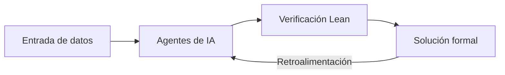

Durante casi noventa años, las ecuaciones de Navier-Stokes permanecieron como una de las barreras más resistentes de las matemáticas puras. Estas ecuaciones describen el movimiento de los fluidos, desde la corriente de un río hasta la turbulencia del aire que rodea un avión, y encierran una pregunta inquietante: ¿pueden dejar de tener sentido en un tiempo finito? El llamado "Problema del Milenio" exigía demostrar si esas ecuaciones siempre generan soluciones suaves o si, por el contrario, pueden desarrollar una singularidad donde la velocidad se vuelve infinita. La resolución presentada por OpenAI marca un punto de inflexión en el que la inteligencia artificial deja de ser una herramienta de procesamiento de datos para convertirse en un motor de descubrimiento de leyes fundamentales, y esa transición redefine el futuro de la ingeniería de infraestructura.

La tesis que sustento en este ensayo es que este avance no se reduce a un logro académico: abre una nueva era en la que la verificación formal y la coordinación de agentes permiten optimizar sistemas físicos reales, desde la refrigeración de centros de datos hasta la aerodinámica avanzada.

## El desafío de los noventa años

La mecánica de fluidos se apoya en principios de conservación de la masa y el momento, pero la complejidad de sus soluciones ha desafiado a las mejores mentes del siglo pasado. Las ecuaciones de Navier-Stokes solo se conocían resueltas en casos simplificados, como las ecuaciones de Euler sin fricción, y su comportamiento general seguía siendo una incógnita que la comunidad matemática consideraba esencial para cualquier sistema que involucre movimiento de aire o agua.

Este vacío teórico se consolidó cuando el Instituto Clay lo inscribió entre los siete "Problemas del Milenio", dotando al reto de una recompensa que reflejaba su profundidad. Durante décadas, la mecánica de fluidos computacional (CFD) resolvió el problema de forma práctica sin necesidad de demostrarlo formalmente, lo que reveló una tensión entre lo aplicable y lo demostrable.

Como observó [Nature](https://www.nature.com/articles/d41586-026-02842-5), la magnitud de este avance matemático trasciende el ámbito académico, pues toca los cimientos teóricamente más sólidos de una disciplina que sostiene industrias enteras. La pregunta no era solo técnica, sino que revelaba hasta qué punto nuestras herramientas dependen de verdades aún no demostradas.

## La revolución de los agentes y la verificación formal

La metodología de OpenAI rompió con el esquema tradicional de la demostración matemática al coordinar diez mil agentes en paralelo durante ochenta y ocho horas, delegando en cada uno tareas específicas dentro de un proceso coordinado. Este diseño permite explorar espacios de solución que un solo investigador jamás recorrería, pero su verdadero innovador reside en la verificación.

El resultado se formalizó en Lean, un sistema de verificación de pruebas matemáticas por computadora que garantiza que la lógica es sólida y no una simple alucinación del modelo. Sin esta capa de validación, cualquier hallazgo en matemáticas puras carecería de validez científica, pues la intuición de un sistema generativo no basta para sostener una verdad universal.

La prueba demostró que un vórtice puede contraerse y girar cada vez más rápido hasta que la velocidad "explota" en un punto, mientras la energía total permanece finita. Esta conclusión, presentada según [la publicación oficial de OpenAI](https://openai.com/index/navier-stokes-solution), confirma que la arquitectura de agentes puede alcanzar lo que la investigación humana había postulado pero no cerrado.

*Figura 1: Ciclo de datos que conecta los agentes de IA con la verificación formal en Lean.*

El siguiente diagrama esquematiza cómo el sistema no avanza en línea recta, sino mediante un bucle de retroalimentación donde la verificación devuelve errores a los agentes. Este mecanismo es clave: sin el ciclo de validación, el proceso sería irreproducible y, por tanto, científicamente inservible.

## Implicaciones en la ingeniería de infraestructura

La precisión en el modelado de flujos tiene un impacto directo en la refrigeración de centros de datos, donde los sistemas de enfriamiento por líquido dependen de entender con exactitud cómo se comportan los fluidos bajo carga térmica intensa. Un control más fino de la turbulencia permite reducir el consumo energético de infraestructuras que ya devoran una parte significativa de la electricidad global.

En el ámbito de la aerodinámica y el diseño, esta precisión se traduce en vehículos más eficientes y en sistemas de defensa más predictivos, donde cada gramo de resistencia importa. La capacidad de anticipar singularidades y comportamientos extremos transforma el diseño desde la raíz, no como un ajuste posterior, sino como una condición desde el origen.

La resolución también abre la puerta a una integración vertical más profunda de la tecnología, donde el dominio de estas leyes fundamentales permite optimizar toda la cadena de valor. Como analizo [Scientific American](https://www.scientificamerican.com/article/did-openai-solve-the-wrong-navier-stokes-problem/), el debate sobre si las aproximaciones clásicas son suficientes para el diseño de refrigeración y aerodinámica sigue abierto, pues la validez matemática no siempre se traduce en ventaja práctica inmediata.

## El futuro de la IA en la ciencia pura

Lo que este avance revela es la transición de la inteligencia artificial de "asistente" a "descubridor" de leyes fundamentales, un cambio de rol que reconfigura la relación entre humanos y máquinas en la investigación. Durante mucho tiempo, los sistemas generativos se limitaron a procesar o sintetizar conocimiento existente; ahora pueden proponer verdades nuevas validadas por lógica formal.

Este nuevo estatus exige un escrutinio riguroso sobre el crédito del descubrimiento. Investigadores independientes, como Tristan Buckmaster y Levent Alpöge, trabajaban en soluciones similares para casos relacionados, lo que suscita un debate activo sobre la autoría en la ciencia asistida.

Como reportó [Quartz](https://qz.com/openai-ai-navier-stokes-millennium-prize-math-090826), la revelación de que una IA resuelva un reto de noventa años no es un evento aislado, sino el presagio de un modelo donde la colaboración humano-agente se convierte en la norma. La pregunta que queda es cómo institucionalizar el reconocimiento cuando la creación es colectiva y distribuida.

## Soberanía de hardware y conocimiento

La resolución de Navier-Stokes confirma que la inteligencia artificial puede convertirse en un motor de descubrimiento, pero también expone una dependencia crítica: el dominio de estas leyes fundamentales requiere potencia de cómputo masiva, concentrada en pocas manos. La integración vertical de la tecnología no es solo una ventaja económica, sino una forma de soberanía sobre el conocimiento mismo que sostiene las infraestructuras modernas.

El costo computacional de estas resoluciones sigue siendo elevadísimo, y la implementación práctica de la "solución maestra" sigue exigiendo recursos que few organizaciones pueden asumir. Este desequilibrio sugiere que los beneficios de la innovación tienden a concentrarse, no a distribuirse, mientras la verificación formal permanezca como puerta de acceso exclusiva.

La advertencia que dejo al lector es clara: mientras la IA avance en la ciencia pura, la pregunta no será solo si puede descubrir leyes, sino quién controla las herramientas para verificarlas. ¿Queremos un futuro donde el descubrimiento fundamental esté al alcance de todos, o uno donde dependamos de quien posea el hardware? La respuesta definirá el próximo siglo de la tecnología.
