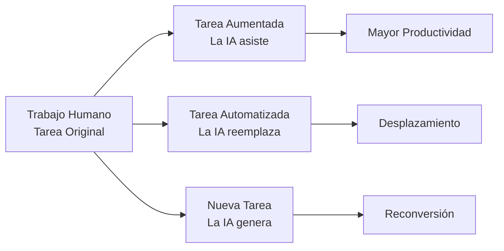

La economía impulsada por la inteligencia artificial no es una trayectoria lineal hacia un único destino, sino un amplio espectro de posibilidades. Este futuro depende de dos variables críticas: la capacidad técnica de los modelos y la velocidad con que empresas y trabajadores deciden adoptarlos. Detrás de cada proyección se esconde una pregunta que pocos se atreven a formular en los pasillos gubernamentales: ¿estamos preparados para un desempleo sin precedentes?

Mi tesis es clara y preocupante. El futuro del trabajo humano se encuentra en una incertidumbre profunda, y esta inseguridad genera una preocupación creciente en la sociedad. Los gobiernos no parecen precavidos ni preparados ante la posibilidad real de un desempleo masivo en la era moderna, aun cuando las propias proyecciones de Anthropic —con su escenario extremo que alcanza un +32,4% de PIB— implican el desplazamiento de millones de trabajadores del conocimiento. Comprendamos por qué este silencio institucional es tan peligroso.

## La economía como un conjunto de tareas

Afirmo que comprender la IA desde la economía de tareas nos obliga a abandonar la noción ingenua de que la automatización elimina empleos enteros de golpe. La realidad operativa es mucho más matizada y, paradójicamente, más inquietante.

Anthropic ha desarrollado un modelo económico que descompone cada profesión en "paquetes de tareas", apoyándose en la taxonomía O*NET del Departamento de Trabajo de los Estados Unidos. Este enfoque, a diferencia de los modelos macroeconómicos tradicionales, permite observar cómo la tecnología afecta unidades mínimas de trabajo.

En este marco, la IA puede realizar tres acciones distintas sobre cada tarea: aumentar el trabajo humano, automatizarlo por completo, o crear funciones que antes ni siquiera existían. La distinción entre aumentación y automatización es clave para entender los riesgos.

El siguiente diagrama esquematiza esta transición fundamental entre las tres formas en que la tecnología incide sobre el trabajo humano.

*Figura 1: Transición de una tarea humana hacia la aumentación, la automatización o la creación de nuevas funciones.*

Este esquema revela que el verdadero dilema no reside en si la IA reemplaza o no, sino en la velocidad de cada transición. Las tareas que se automatizan por completo generan desplazamiento inmediato, mientras que las aumentadas solo compran tiempo a los trabajadores.

## Los tres escenarios de crecimiento

El modelo de Anthropic proyecta tres escenarios principales para el año 2030, y la distancia entre ellos es abismal. Cada uno representa un rumbo distinto para la sociedad y para el mercado laboral.

El escenario modesto prevé un crecimiento del PIB de solo +1,6%, con un impacto limitado sobre el empleo. El escenario sustancial alcanza un +8,3% y conlleva un desplazamiento moderado de trabajadores del conocimiento. El escenario extremo dispara el PIB en un +32,4% mediante capacidades de auto-mejora recursiva y adopción masiva.

La paradoja que debemos confrontar es devastadora. Cuanto mayor es el crecimiento económico proyectado, mayor resulta también el costo humano en términos de reemplazo laboral. Como señaló [El Economista](https://news.google.com/rss/articles/CBMimAJBVV95cUxQQWVBUVd5Q21yVk5qNUdKLXdxcC1kVzNNd1ZLUzlReW1UZlVjdlFZRk1nTEE2NndGMWpUU3ZJYkg5Sm45Wm9rVF9UZWo5M2lwSUdBSVc2MFhvdktnZGVLOUlhdlpLa3l0akRpQlczZG5OenJkSkg2S0pBbllPdkRzRlRCV2YwUzZJUTlIZ01BdGliVVdTSFMwV1lQamp2RkZTNHlQSWlERy1PM0hNUFZYNjNyVDEtdTNPU0ZyNTJOcWowMlFPZTM1SzJEZ19DaHpqMFl5ZUVWS0o0YUpyVmVpX2lCS0UwcUlFUTRvdVZzUEh5MHdKY1pWRExSaDZSdVY0dTVvWU5DMWZ6QnBnVlNIVzZ2clBNTVVj?oc=5&ucbcb=1&hl=en-US&gl=US&ceid=US:en), la IA podría agregar un cuarto factor de producción que amenaza directamente a los salarios y a los trabajadores.

Esta evidencia nos obliga a reconocer que el riesgo no es la estancación económica, sino todo lo contrario. Un éxito técnico tan desbordante puede resultar devastador para quienes viven del trabajo remunerado.

## El riesgo oculto del conocimiento

Afirmo que los trabajadores del conocimiento, tradicionalmente considerados a salvo de la automatización, son ahora los más expuestos en los escenarios de alta capacidad. Esta es la gran sorpresa —y pesadilla— del análisis de Anthropic.

Durante décadas, la automatización amenazó principalmente el trabajo manual y repetitivo. Pero los modelos de lenguaje han demostrado capacidades inesperadas en tareas de redacción, análisis y razonamiento que parecían reservadas a los humanos. Como reportó [COPE](https://news.google.com/rss/articles/CBMi5AFBVV95cUxNTWFPcG9qeE1hX0ZtdVM3a00yNGJWOEhmWHhabFNTbGpMeVVCRm54YkxvWlhkeTlmMFYyQngxa0FzZnRaSGZDN19UTzNmTnY1aEhQd3JkUGNjMTJVRXBCbjJRelB3RWlQMGNSRW1iMzducnF0UVBhckFGZENhR2EyNWUwNHBnWTRHTUxQc2ItdTRaQnlwZGdxMG10MGdFYk1KN0lHelFnQUk5VHFyd1ZJRmRCeTVKV25iWm5VTGVaMzRPNmdiT2RVdXlSVDVwT1YydHR1c3FIUnRmdnhXZ2FZRTg5UnDSAeoBQVVfeXFMT2hpV05EY0lORkRwM2RKcnRSb01KdXFwOGNHVmVVdVhCSTRvamNlSkN6aEZhdDBOVkhKU2dzblNNSDBoZ3JQOU9JTnUxRk9CcEZCSUwyT1FFOUlyRG14QTVsMVhjSGlfaC1LUXBNdDJFR2ljSlFzOXVSNDFxeVJPY0JkUFVmUW9VcEVHNlBZeG00dmQ5aTA0aEp3QnY2WmNaSEpJVGlIc3FwNnFQa3U5MjQ4N3pSeFNsdThwRmdnaU8zMXZ5WW80UTVUR2pGWjJnZkZIT3FGaVo4T1pLTUxkY1ZNZ1hnUG56NzNn?oc=5&ucbcb=1&hl=en-US&gl=US&ceid=US:en), la productividad puede incrementarse entre un 30% y un 50% por trabajador, aunque "puede tener efectos bastante perniciosos".

Este es el núcleo de mi preocupación. La velocidad de ajuste del mercado laboral se ha convertido en un cuello de botella crítico. El tiempo que tarda un trabajador en aprender nuevas habilidades puede ser insuficiente frente a la rapidez con que la tecnología vuelve obsoletas sus competencias actuales.

El resultado es una brecha que [El País](https://news.google.com/rss/articles/CBMiggJBVV95cUxOVEFZMUFQU3JGUVRIMmdVd1MtQUdfemhDR0thbHdwSEhxcnBqQmtfLVg0dXVmajlhRjk1TTNBT1kxbWFCalZWTHFkUkt1c19uUGdSRTIySXlqbnlaaE9xLTlCUU8tbXdHMlVDell3S3lkUmFfcU5saEpoSHczU3pEc2NHMVQxOFlQSU9GdHk3eng4aXUzVENSaUFFeVpzSUsxQ21sQzdBbEdyQmNSWVR1TVJxdVUwNlEzZW5LejRhSXVFbXIyOUo2UlRfZ3NaTTVaREdGMjE4V2Q2eTROU0xIYm5UbUo4ZUhFQnoxTU9sTW9YN01OSnRVN3A3NjJ3MlhuM2fSAZYCQVVfeXFMTWpyTTdfaEViM25ENW5ST3VRdl9qOUl3VTJmZWZaUDVlSnI3UXhmc2tzejBUY2tFUmdSQVVTZ3c4UW9nR0QycF9PLURBNG5Cb0ZKSUo1RG16WGVWXzBhYzdnZlJ6SWRaZVVuMWphSlBEZngyZFR5XzZiOEJNYzRCVzRQWTJMV3BEQzF5QmMteUlQNlp6NmtmOTlPck1RU3AtRkU4TkVfOXF0REY2MzB1WG5ZUklnUGxJUHVhaXU2MHFTZGIxcnlpVnFQajZnY2tHOEZDM0NHdm9kUzlfbVo4Y0ZYc1JYQWRIRGhlTDRpZEZ1WjVJcUhRQmFIQy1hTHNhcnhReE80MmM4YUhNcU5lZTdrcTNyTmc?oc=5&ucbcb=1&hl=en-US&gl=US&ceid=US:en) ya observa en los negocios: las empresas rezagadas no podrán sostener los salarios ni atraer personal. Esta divergencia amenaza con fracturar la sociedad entre quienes dominan la tecnología y quienes quedan relegados.

## El verdadero dilema de la distribución

La riqueza generada por la IA extrema será enorme, pero el desafío principal no será producirla, sino repartirla. Aquí reside el trade-off entre capital y trabajo, y es donde la falta de preparación institucional se vuelve insoportable.

A medida que la IA eleva la productividad, una fracción creciente del valor generado tiende a fluir hacia el capital —los dueños de la tecnología y los recursos— en lugar de hacia los salarios de los trabajadores. Como analizó [La Nueva España](https://news.google.com/rss/articles/CBMinwFBVV95cUxNd3RtSnE4bk90enBBeG9PUC1Ba0RHcWk2OXhObUtoQk1DTWhmRlRtc1FnMm0zUmlMdjJ0c203ZnExdzN0Tl9mLVlHWlFYTW9rTVUzNHlsbk0tdXh4VHg0LU1nMnlnRTltMVpoMm0yYXVWMGc1c0s5UUNNQWJiY1pLb2R5NDlYcGFXNVN0RnB0T3F1d3B3OThyeS0tV1VhQlHSAaQBQVVfeXFMTk1RZ1J5MVNEeHJRMWFmcmpieTBPVnZnajhHTTNRZWpYVEZ6RmpnTVo0TWx0OElDMlZLOXhJRElBM2lRTVpwdmZJMDlxNlA5OWpoVWpNLTBFVDkwa0tYWTN3TzZRYTJtQXdhN3ZsUHpic2p6dWsyX1ZwX1RPLXE1MXBLc1ZQNVExUW1iak5Yci1mWnI0RUZuSzV1eHJubVp1X0xCdjY?oc=5&ucbcb=1&hl=en-US&gl=US&ceid=US:en), la IA puede elevar la productividad pero también concentrar la empresa.

Este es el corazón de mi crítica. Los gobiernos no han diseñado mecanismos creíbles para anticipar esta redistribución forzada. No existen políticas públicas robustas que garanticen que los beneficios de la automatización lleguen a quienes pierden sus empleos.

El modelo de Anthropic tampoco incluye respuestas políticas directas, robots hipercapaces ni ciclos económicos agregados. Estas limitaciones no minimizan el aviso; al contrario, lo intensifican, pues sugieren que incluso las proyecciones más conservadoras podrían quedarse cortas.

## Hacia un debate institucional urgente

Reafirmo que la incertidumbre sobre el futuro del trabajo humano debe convertirse en una prioridad política inmediata, no en un lujo académico. Los gobiernos no están precavidos ante un desempleo masivo que las propias proyecciones técnicas consideran plausible.

El escenario extremo de Anthropic no es ciencia ficción: es un camino real que combina auto-mejora recursiva y adopción masiva. Recorrerlo significaría enriquecer a la sociedad mientras desplaza a millones de trabajadores del conocimiento sin red de contención.

La pregunta que dejo abierta es incómoda: ¿qué mecanismo político inventaremos antes de que el mercado decida por nosotros? Mientras el silencio institucional persista, la brecha entre la riqueza generada y su distribución seguirá ampliándose, y serán los trabajadores quienes paguen el precio de nuestra imprudencia colectiva.
