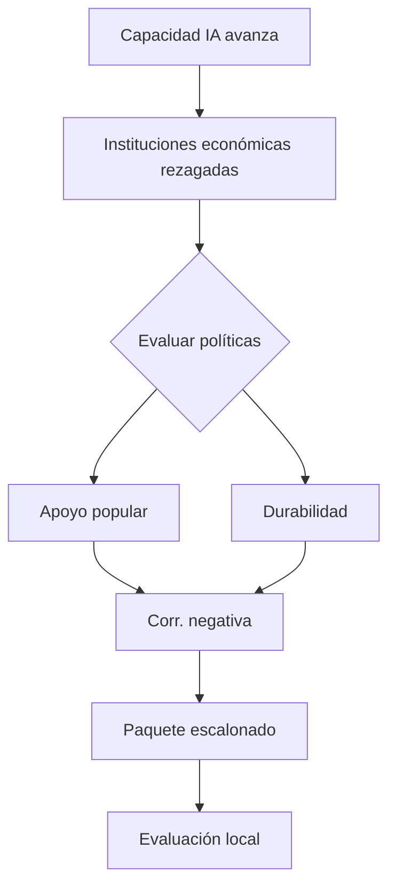

El 16 de septiembre de 2026, Google DeepMind publicó un documento que aborda una pregunta que la mayoría de la industria evita deliberadamente: si la inteligencia artificial disrupa el mercado laboral en gran escala, qué política económica debería adoptar el Estado. El trabajo, firmado por Julián Jacobs y Alex Imas, no se limita a pronosticar el desastre ni a denunciarlo; propone un paquete escalonado centrado en un impuesto negativo sobre la renta. Mi tesis desde la primera línea es clara: conviene leer este paper no como la receta de un futuro deseable, sino como el capítulo dos de una trilogía. Conecta con la discusión sobre modelos que corren más de lo que controlamos y con el planteamiento del desempleo estructural; sin embargo, sus datos enriquecen y matizan, no confirman, la respuesta que yo abogaba entonces.

La relevancia de esta entrada reside en su metodología. Por primera vez un laboratorio de vanguardia aplica un triple método para evaluar políticas de redistribución ante una posible AGI: análisis económico tradicional, una encuesta a 2.019 estadounidenses y un panel de agentes entrenados con la personalidad de 51 economistas. Ese esfuerzo cuantitativo es lo que lo convierte en un documento obligatorio, aunque sus conclusiones deban leerse con prudente escepticismo.

## El paper pregunta lo que nadie quería formular

El debate sobre la IA y el empleo se había quedado atrapado en dos polos ideológicos, y esa es la acusación que lanzan los autores contra su propio campo. Los utopistas afirmaban que la máquina resolvería todo, a menudo defendiendo una renta básica universal como respuesta natural. Los escépticos reducían todo a hype y negaban el fenómeno. En ambos casos, las propuestas de política descansaban en convicción, no en evidencia de robustez ante distintos escenarios.

La evidencia que sostiene esta lectura se encuentra en el propio abstract del trabajo. Como revela [la publicación en SSRN](https://papers.ssrn.com/sol3/Delivery.cfm?abstractid=7470000), los autores aplican una metodología triple que combina el análisis económico tradicional, una encuesta representativa nacional y un panel simulado de agentes. Esa combinación marca un antes y un después en cómo se estudia la redistribución ante la transformación económica.

Durante años el tema se discutió por convicción política o por intuición filosófica. DeepMind intenta cerrar esa brecha con metodología cuantitativa, tratando las políticas como hipótesis que pueden someterse a prueba bajo múltiples perturbaciones. Para un ingeniero de sistemas, ese cambio de paradigma es lo interesante: convierte lo ideológico en algo medible, y eso es exactamente el tipo de pregunta que a un arquitecto le encanta.

## Qué mide y qué no puede medir

Todo instrumento de medición arrastra sus propios límites, y este paper no es la excepción. Los autores evalúan hasta veinticuatro intervenciones —según su ficha— sobre cuatro dimensiones: el bienestar agregado, la agencia y el empoderamiento socioeconómico, la viabilidad de implementación y la durabilidad entre escenarios. Esa triple contabilidad es rigurosa, pero el número de intervenciones y el método tienen fisuras que conviene exponer.

El hallazgo central, sin embargo, vale por sí solo. Según [SSRN](https://ssrn.com/abstract=7470000), existe una correlación negativa entre el apoyo popular y la durabilidad entre escenarios. Es decir, las políticas más queridas por el público tienden a ser menos robustas ante distintas perturbaciones, y viceversa. Ese dato rompe de raíz la ilusión de existir una política que guste a todos y funcione siempre.

Otra fisura exige cautela. El panel de agentes IA con la personalidad de 51 economistas es una simulación, no un panel real. Sus conclusiones dependen del marco y los supuestos escogidos por los autores, no de economía futura observada. Un ingeniero debe recordar que cualquier modelo es tan bueno como los supuestos que lo sostienen; extrapolar sus resultados a la realidad es un salto que el propio documento no reclama.

## El paquete propuesto y su lógica escalonada

Lo que propone DeepMind no es una sola política, sino un conjunto dinámico. El paquete combina un seguro de desempleo ampliado, un impuesto negativo sobre la renta y redistribución de capital, diseñado para evolucionar a medida que cambian las condiciones del mercado laboral. Esa naturaleza escalonada es su rasgo más inteligente.

El funcionamiento del impuesto negativo sobre la renta es lo que conviene entender bien: bajo ciertas reglas, quienes tienen ingresos bajos reciben una transferencia en vez de pagar un impuesto neto. Su viabilidad depende por completo del diseño concreto, de las tasas y de los umbrales que lo regulan. Un detalle técnico que decide si salva o fracasa.

La implicación para la ingeniería de políticas es notable. En lugar de una receta fija que se quiebra ante la primera perturbación, los autores proponen un sistema que se reconfigura con el entorno. Ese enfoque evolutivo replica la lógica de los propios sistemas de software modernos: despliegues continuos, canaries y retroalimentación. La diferencia es que aquí el "sistema" es el contrato social de un país.

## Dos caminos, dos lecturas

Este documento solo cobra sentido si se lee como capítulo dos de una trilogía. El primer eslabón, el post sobre modelos no seguros, estableció que la industria reconoce correr más de lo que controla. El segundo eslabón, [La Gran Desconexión](https://sinapsis.jbaez.net/2025/11/28/la-gran-desconexion-ia-y-desempleo.html), planteó la brecha entre la eficiencia productiva y la estabilidad del empleo y abogaba por un nuevo contrato social, aun sin precisar cuál.

La conexión entre ambos es directa. En aquella entrada defendía una renta básica universal como respuesta, pero reconocía que ignoraba su forma concreta. Este paper aporta esa respuesta evaluada con datos, tratando la renta básica como una de las veinticuatro intervenciones. Sin embargo, el hallazgo de la correlación negativa entre popularidad y durabilidad enriquece y matiza, no confirma.

La implicación práctica es la soberanía institucional. Como señala [Singularidad.si](https://sinapsis.jbaez.net/2025/11/28/la-gran-desconexion-ia-y-desempleo.html), no existe una política universalmente óptima: la informalidad laboral, los sistemas fiscales y la capacidad institucional difieren entre países. Toda propuesta general exige, por tanto, una evaluación local antes de convertirse en ley.

Para el lector ingeniero, la lección es doble. La soberanía computacional e institucional es la respuesta a las recetas centralizadas: lo que funciona en un país puede colapsar en otro. Convierte el dato en advertencia.

*Figura 1: La tensión entre popularidad y durabilidad que obliga a localizar toda política.*

El diagrama resume la lógica del documento: la presión sobre las instituciones obliga a evaluar, y esa evaluación revela una tensión estructural. La consecuencia es que ninguna receta centralizada basta; la respuesta exige adaptación local, que es precisamente el valor que defiende esta trilogía.

## Hacia un contrato social evaluado

La tesis que defendía desde la introducción se reafirma a la luz de lo argumentado, pero con un matiz que la profundiza. El paper de DeepMind no es la receta de un futuro deseable, sino el capítulo dos de una trilogía que conecta el control con las instituciones. Sus datos enriquecen y matizan la respuesta que yo abogaba, y su mayor aporte es demostrar que no existe una política universalmente óptima.

La advertencia que deja el documento es memorable. La correlación negativa entre popularidad y durabilidad sugiere que buscar la política que guste a todos es una trampa: lo más votado suele ser lo menos robusto. Un ingeniero de sistemas debe aplicar esa lección a su propio trabajo: las soluciones elegantes que todos aman a menudo son las que se quiebran bajo la primera perturbación real.

La pregunta que deja abierta al lector es estratégica. Ante la disrupción, ¿construimos contratos sociales evaluados con datos o seguimos decidiendo por convicción ideológica? La respuesta definirá si las instituciones acompañan a la capacidad, o si ambas siguen corriendo por caminos separados.
